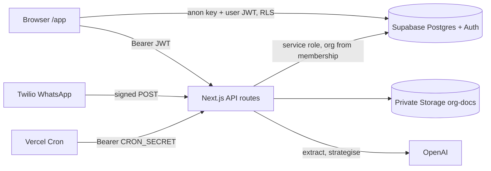
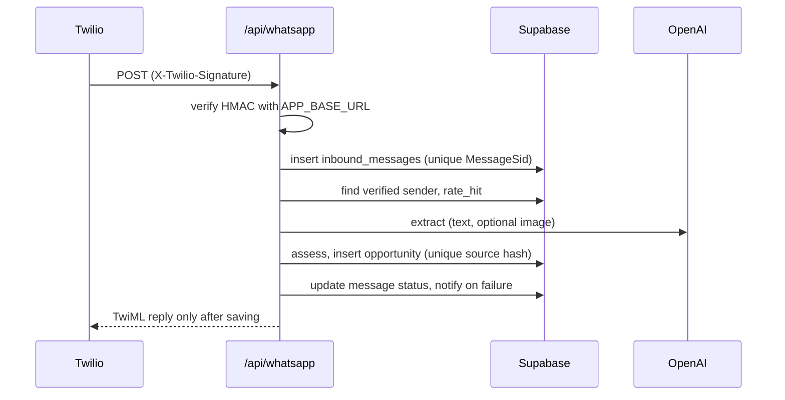

# FundFlow Technical Requirements
Describes the repository as built. Not implemented: queue, email service, multi-organization membership, Meta provider. No live integration has been verified.

## Stack
Next.js 14 App Router (JavaScript), React 18, Supabase (Auth, Postgres with RLS, private Storage), OpenAI (optional), Twilio WhatsApp, Vercel (hosting and one daily cron), Zod, Vitest, PGlite, Python Playwright (browser smoke).

## Architecture

## Trust zones
| Zone | Holds | Rule |
|---|---|---|
| Public client config | `NEXT_PUBLIC_SUPABASE_URL`, anon key | Safe only because every table has RLS |
| Authenticated user | Browser calls with the user's JWT | Can only do what RLS, column grants and triggers allow |
| Server, user JWT | `/api/opportunity` uses the caller's JWT | RLS applies and triggers record the real actor |
| Server, service role | intake, retry, reanalyse, senders, invites, documents, whatsapp, cron | Org comes from `organization_members`, never from the request. Must filter by org manually |
| External | OpenAI, Twilio, Vercel Cron | Inputs treated as untrusted. Twilio signature and cron secret verified |

## Authorization model
`ctx(req)` verifies the JWT, loads the caller's single membership and returns `orgId` and `role`. Roles: owner, admin, member. Memberships can be changed only through `set_member_role` and `remove_member` (no client write policy). Invites are written only by `/api/invites`.

## Browser writes (confirmed against RLS and tests)
| Write | Protection | Tested |
|---|---|---|
| `opportunities` update (status, assignee) | RLS org, status CHECK, assignee guard trigger, org immutable trigger | PGlite |
| `opportunities` update (application URL) | Moved to `/api/opportunity` (URL validated) | mocked route |
| `opportunities` delete | RLS admin or owner | PGlite |
| `opportunity_tasks` insert, update | RLS org, composite FK, assignee guard | PGlite |
| `opportunity_notes` insert | RLS org and `author_id = auth.uid()` | PGlite |
| `notifications` update | RLS owner of row, column grant on `read_at` only | PGlite |
| `organizations` update (vault, wizard) | RLS admin or owner. Member denial tested. The allowed admin path is covered only by the mocked browser run | PGlite, browser (mock) |
| RPCs: create_organization, accept_invite, set_member_role, remove_member | Security definer with checks | PGlite |
Decision: keep these in the browser. Moving them adds code without removing a gap, because the database enforces the rules.

## Data model
`organizations` 1-n `organization_members` (unique user). `organizations` 1-n `opportunities` (unique id+org, unique org+source_hash). `opportunities` 1-n `opportunity_tasks`, `opportunity_notes`, `opportunity_activity`, `opportunity_analyses` (composite FK to same org). `organizations` 1-n `whatsapp_senders` (unique phone), `inbound_messages` (unique provider+message id), `org_documents`, `organization_invites` (hashed token). `notifications` per user (unique user+dedupe_key). `rate_limits` (service only). Constraints: score 0 to 100, status checks, funding non-negative and ordered, dates ordered.

## Processing and limits
- Extraction: Zod-validated, nullable, sanitized (bad dates, contradictions dropped). Missing OpenAI key selects the labelled demo extractor.
- Scoring: deterministic weights (mission 30, geography 20, applicant 20, financial 15, program 15, normalized, configurable). Hard conflict caps score at 35.
- WhatsApp: synchronous, 24 s work budget inside `maxDuration` 30. No queue.
- Retry: `claim_retry` atomic, cap 3, in-flight guard 2 minutes. Images are not stored.
- Rate limits: `rate_hit` atomic upsert, fails closed. Per user, per sender, per org daily AI cap (200). No token or cost accounting.
- URL fetch: public hosts only, redirect checks, size and type limits. DNS rebinding window remains.
- Uploads: 4 MB, content sniffing, declared-length precheck. Chunked bodies without a length rely on the host limit.
- Reminders: `notify_deadlines()` with unique dedupe keys, UTC dates, in-app only.

## Operations
Logging: no application console logging. Stored: full WhatsApp message text, short error strings. Retention: none defined. Backup: enable Supabase backups or point-in-time recovery before every migration. Rollback: no down migrations, restore from backup.

## Environment
See `.env.example` for required versus optional variables and the behaviour when each is absent.

## Tests
`npm test` (66): unit, PGlite Postgres (migrations, RLS, roles, retry, reminders), mocked route tests, static security checks. `tests/browser/smoke.py`: real Chromium with a mocked backend. No live Supabase, OpenAI or Twilio tests.
